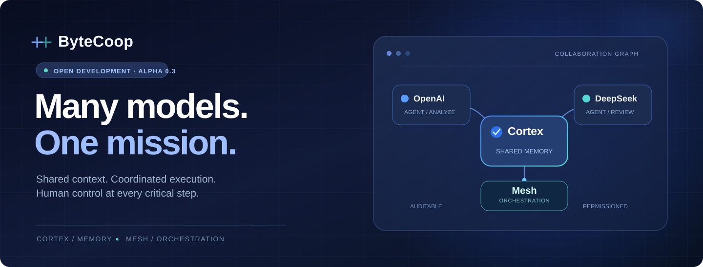

<div align="center">



<br />

<a href="#the-idea"></a>
<a href="#current-status"></a>
<a href="#how-it-works"></a>
<a href="#roadmap"></a>

<br /><br />

**One workspace. Multiple AI models. Shared memory. Human control.**

Built for people who want their AI assistants to collaborate, not work in isolated silos.

[Explore the architecture](#how-it-works) · [See the roadmap](ROADMAP.md) · [Read the security model](SECURITY.md) · [Contribute ideas](CONTRIBUTING.md)

</div>

---

## The idea

Today, different AI models often work in separate conversations. Context gets lost, work is duplicated, and it is difficult to see **who did what**.

**ByteCoop** explores a different model: an environment where multiple AI providers can work on the same project, share *permitted* context and hand work to one another — with the human retaining control over important decisions.

<table>
<tr>
<td width="50%" valign="top">

### Cortex <sub> / persistent memory</sub>

**The context layer.** Stores project memory, documents, versioned decisions and the provenance of agent outputs.

- Project-scoped context and permissions
- Auditable decision history
- Shared and private memory boundaries

</td>
<td width="50%" valign="top">

### Mesh <sub> / orchestration</sub>

**The coordination layer.** Tracks tasks, approval checkpoints, agent handoffs and execution events.

- Multi-step agent workflows
- Human review before paid API calls
- Traceable execution and cost records

</td>
</tr>
</table>

## How it works

<div align="center">

</div>

The current prototype supports an **OpenAI → DeepSeek → OpenAI** sequence. Each stage has its own provider call, evidence record and approval flow.

```text
User request
  └─ OpenAI      → initial response and proposed plan
       └─ Human → reviews and approves the plan
            └─ DeepSeek → receives permitted context from Cortex
                 └─ Human → approves each real provider call
                      └─ OpenAI → final review / synthesis
                           └─ Cortex + Mesh → retain results and trace
```

> **Important:** the Alpha 0.3 implementation still has a known collaboration-quality issue: the first model may produce a plan without fully answering the initial request. Correcting that behavior is a priority for 0.4. [Details →](KNOWN_LIMITATIONS.md)

## Built with a focus on control

| | Capability | Alpha 0.3 |
|:--:|---|---|
| ◈ | **Conversation-first UX** | Projects, conversation history and a minimal chat layout |
| ◉ | **Shared context** | Cortex memory, provenance and permission-aware retrieval |
| ⇄ | **Multi-model handoffs** | Live-call paths for OpenAI and DeepSeek |
| ◷ | **Human checkpoints** | Explicit approval for real calls and bounded budgets |
| ⌁ | **Local-first storage** | Embedded PGlite with persistent local data |
| ⛨ | **Credential handling** | Windows DPAPI-protected provider keys on supported setups |
| ◇ | **Auditability** | Logged events, decisions, inputs and agent transitions |

## Current status

**Alpha 0.3 · Local developer prototype · Not production-ready**

The first live three-step OpenAI → DeepSeek → OpenAI smoke test completed, with a reported aggregate provider charge of **$0.001649** for that specific run. A separate Windows installation run reported **65 passing backend tests and 11 passing UI tests**; these are developer tests, not independent security certification.

The prototype is **not** a publicly hosted service. Claude and Gemini execution, streaming output, secure autonomous development tools, and multi-user production authentication are **not yet implemented**.

### Source availability

This public repository is currently a **project showcase and documentation space**. The installable Alpha 0.3 source has **not yet been uploaded here** while its publication scope, licensing and security review are finalized.

As a result, cloning this repository **does not install ByteCoop yet**. Windows installation guidance will be linked alongside the approved source release.

## Roadmap

| Milestone | Focus | State |
|---|---|---|
| **0.1** | Cortex and Mesh foundations | Prototype |
| **0.2** | Provider connections and guarded approvals | Prototype |
| **0.3** | Chat UX, persistent conversations, real provider workflow | Tested locally |
| **0.4** | Accurate agent handoffs, relevant memory retrieval, clearer errors | **Planned** |
| **0.5** | Optional developer workspace and isolated terminal | Proposed |
| **0.6** | Safe project execution, previews and reviewable changes | Proposed |

[View the full roadmap →](ROADMAP.md)

## Documentation

| Document | Contents |
|---|---|
| [Architecture](docs/ARCHITECTURE.md) | Trust boundaries, data flow, Cortex and Mesh |
| [Roadmap](ROADMAP.md) | Upcoming milestones and quality gates |
| [Changelog](CHANGELOG.md) | Verified changes and known issues |
| [Known limitations](KNOWN_LIMITATIONS.md) | Honest description of what Alpha cannot do |
| [Security](SECURITY.md) | Safe testing and vulnerability reports |
| [Contributing](CONTRIBUTING.md) | Feedback and contribution process |

## Principles

**Simple for everyone. Powerful when needed.**

The chat remains the default interface. Developer-specific tools should appear only when relevant, never overwhelm non-technical users, and never silently execute commands on a user's machine.

**Proof over hype.** We distinguish observed functionality from planned capabilities. Every serious collaboration claim should be reproducible, measurable and traceable.

---

<div align="center">
  <sub><b>ByteCoop</b> · Multiple AIs. One shared intelligence.</sub>
  <br />
  <sub>Built in public, with care for permission boundaries and human agency.</sub>
</div>
