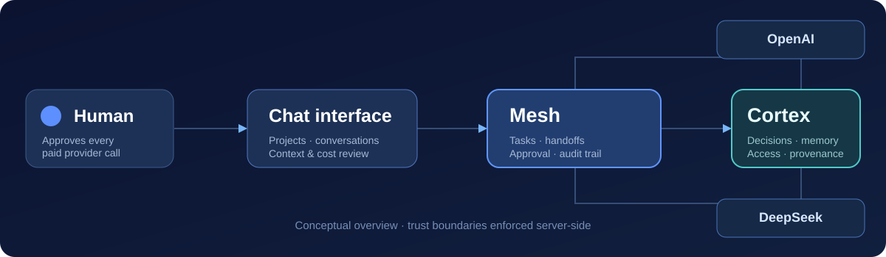

# ByteCoop architecture

> **Alpha 0.3**, local-first, developer-oriented prototype. This is an overview, not a formal security assessment.

## Components

| Component | Responsibility | Trust boundary |
|---|---|---|
| React / Vite frontend | Conversations, project navigation, context review, approval dialogs | The browser never grants permissions on its own |
| Node HTTP application | Local request handling, authentication checks, API routing | Enforces origin and authority checks server-side |
| **Cortex** | Persistent project context, scoped memory, decision revisions and provenance | Restricts reads/writes by project and agent permissions |
| **Mesh** | Task lifecycle, sequenced agent calls, approvals, audit log | Does not let agents self-approve privileged actions |
| Provider adapters | Calls supported OpenAI/DeepSeek APIs | Only authorized context is prepared for each request |
| Vault | Local provider-key handling with Windows DPAPI in supported configuration | Keys are not read back to browser from settings endpoints |
| PGlite | Embedded transactional PostgreSQL-based persistence | Local application data, not a cloud multi-tenant database |

  

## A mission lifecycle

1. The founder enters a project-scoped request in the chat.
2. A mission with explicit participants and cost limits is created.
3. The first provider is asked to propose a plan. **Known limitation:** it may return the plan instead of the substantive answer.
4. Human-approved plan and permitted memory become inputs to the next stage.
5. Provider calls require distinct human authorizations and cost reservations.
6. Results and event metadata are recorded for review and future authorized use.

These operations are designed to make cross-provider handoffs inspectable instead of hidden behind an opaque agent conversation.

## Core safety properties

- The source of authorization is server-side identity and approvals, **not** model-generated text.
- Project identity must be consistent across conversations, tasks, decisions and documents.
- An agent's output cannot upgrade itself to a human-approved decision.
- Interrupted or ambiguous real calls are not automatically replayed as if free.
- Context review is important: project-wide authorized documents may include older material that is not relevant to the current task.

## Current technical boundaries

- PGlite is used for local persistent storage.
- The application is **not** a hardened publicly exposed multi-user server.
- The existing interface uses polling, not token streaming.
- OpenAI and DeepSeek are available for real execution; Claude/Gemini execution is incomplete.
- A development terminal or unattended host command execution **is not implemented**.
- Local project data and provider secrets must never be committed to the repository.

[Known limitations](../KNOWN_LIMITATIONS.md) · [Security policy](../SECURITY.md) · [Roadmap](../ROADMAP.md)
